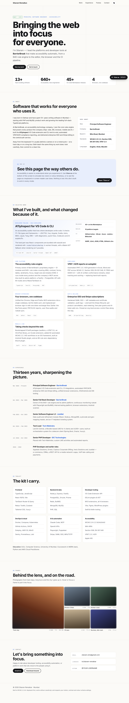
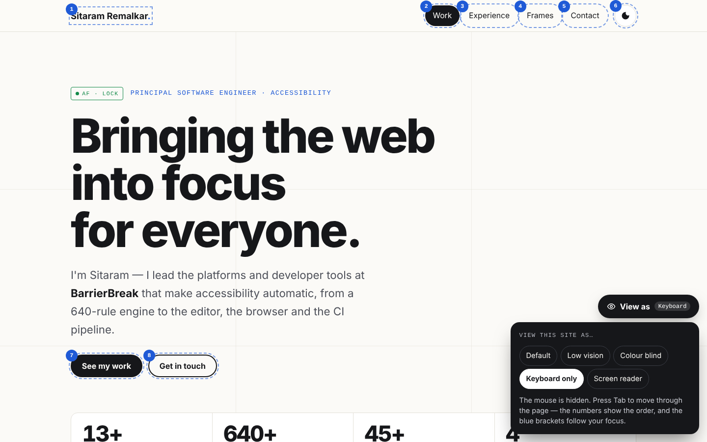
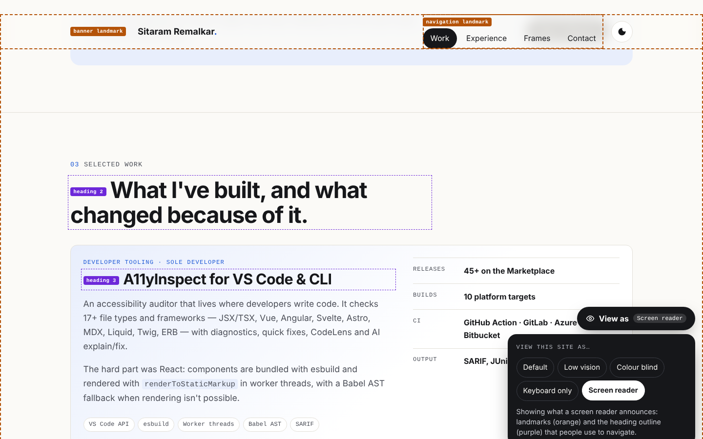

# Sitaram Remalkar — Portfolio

**Bringing the web into focus, for everyone.**

Personal site of Sitaram Remalkar, Principal Software Engineer at BarrierBreak, building full-stack platforms,
developer tooling and accessibility automation.



## Highlights
- **Focus-pull hero:** the headline sharpens like a camera lens finding focus, then the AF brackets lock.
- **View this site as…:** a live demo that simulates low vision, colour blindness, keyboard-only and
  screen-reader use. It shows the accessibility this site is built on.
- **Camera-style keyboard focus:** AF brackets follow your Tab key around the page.
- Built to **WCAG 2.2 AA**. Works without JavaScript, and respects reduced motion, forced colours and light/dark preference.
- Zero dependencies. Plain HTML, CSS and JS on GitHub Pages.

| Keyboard only | Screen reader |
|---|---|
|  |  |

## Run locally
```bash
python3 -m http.server 8000   # then open http://localhost:8000
```

## Deploy (GitHub Pages)
1. Create a repo on GitHub (name it `<your-username>.github.io` to serve it at the root URL).
2. `git remote add origin git@github.com:<your-username>/<repo>.git && git push -u origin main`
3. Repo → **Settings → Pages** → Source: *Deploy from a branch* → `main` / `(root)`.

## Structure
```
index.html      page content
styles.css      design tokens, layout, animations
script.js       focus pull, scroll reveal, View-as simulations, theme toggle
favicon.svg
docs/           screenshots and earlier design concepts (not linked from the site)
```
